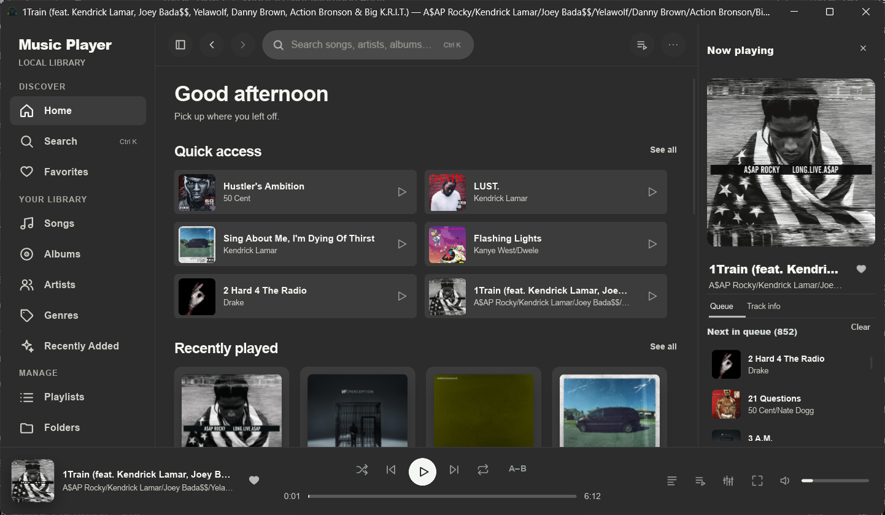
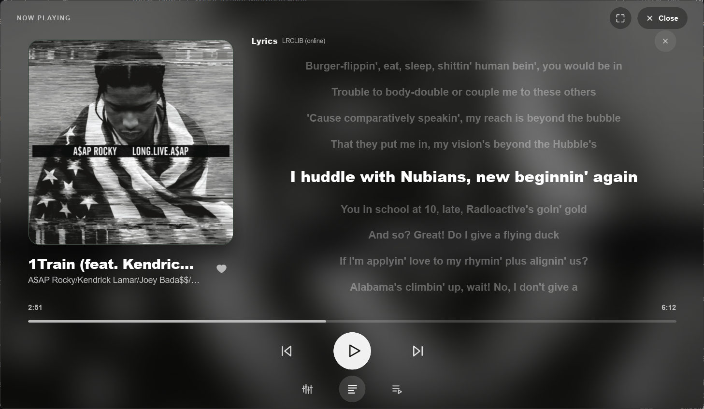
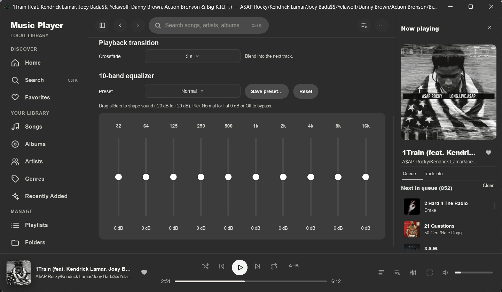
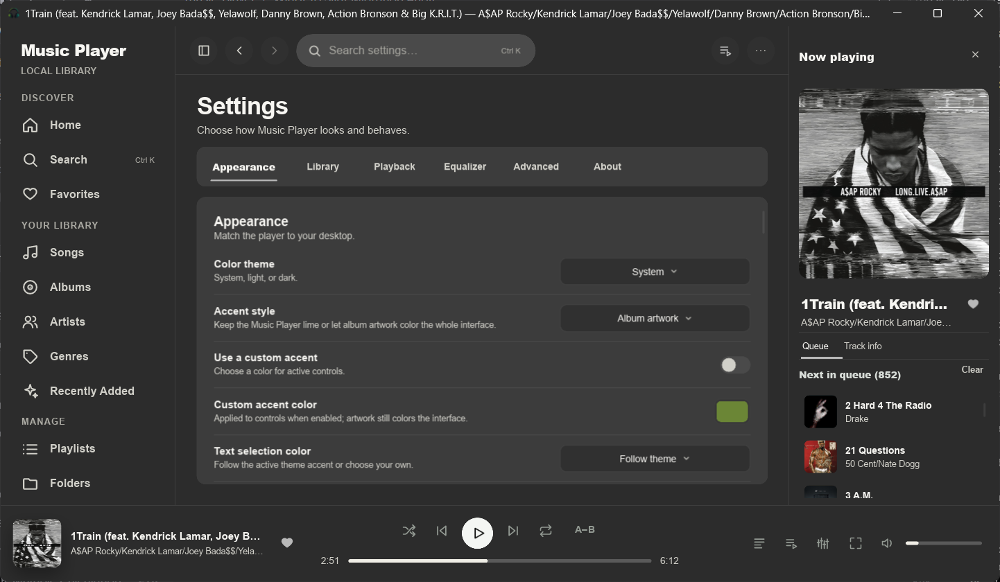

<p align="center">
  
</p>

<h1 align="center">Music Player</h1>

<p align="center">
  Native Windows desktop audio &amp; video library player built with <strong>Rust</strong>, <strong>Slint UI</strong>, <strong>LibVLC</strong>, and <strong>SQLite</strong>.
</p>

<p align="center">
  <a href="https://github.com/kalabhaftu/music-player/releases/latest">Download for Windows</a> ·
  <a href="docs/index.html">User Guide</a> ·
  <a href="docs/developer.html">Developer Docs</a> ·
  <a href="CHANGELOG.md">Changelog (v2.0.0)</a>
</p>

<p align="center">
  
</p>

---

## Screenshots

| Immersive Now Playing & Synced Lyrics | Crossfade & 10-Band Equalizer | Settings & Theme Customization |
| :---: | :---: | :---: |
|  |  |  |

---

## Repository Structure

| Implementation | Path | Status | Stack |
| :--- | :--- | :--- | :--- |
| **Rust Native App** | [`crates/`](crates/) & [`Cargo.toml`](Cargo.toml) | **Primary (v2.0.0)** | Rust + Slint UI + LibVLC + SQLite |
| **WebUI Desktop App** | [`legacy/src/MusicPlayer.App/`](legacy/src/MusicPlayer.App/) | **Retired / Archived** *(see [ARCHIVE_NOTICE.md](legacy/src/MusicPlayer.App/ARCHIVE_NOTICE.md))* | C# / WinUI 3 + WebView2 + Vanilla JS |
| **Avalonia Native UI** | [`legacy/src/MusicPlayer.Desktop/`](legacy/src/MusicPlayer.Desktop/) | **Experimental Reference** *(see [AVALONIA_UI_AUDIT.md](legacy/AVALONIA_UI_AUDIT.md))* | C# / Avalonia 11.2 XAML MVVM |
| **Shared .NET Core** | [`legacy/src/MusicPlayer.Core/`](legacy/src/MusicPlayer.Core/) | **Legacy Shared Library** | .NET 10 library shared by both C# apps |

## Features

- Search and browse songs, albums, artists, genres, favorites, history, and playlists.
- Scan local folders with exclusions, progress, pause, resume, and cancel controls.
- Manage the queue, shuffle, repeat, A–B repeat, volume, crossfade, output device, and ten-band equalizer.
- Edit supported tags with backups; view lyrics, search LRCLIB on request, and inspect track details.
- Find exact duplicate files, inspect their locations, and open them in File Explorer.
- Dedicated native video window with subtitle selection, speed control, PNG snapshots, and fullscreen.
- Use Windows media controls (SMTC), media keys, file activation, optional tray behavior, and paused-session restore.

## Build

### Primary: Rust Native App (Repository Root)

Use the Rust toolchain (stable) with MSVC and Windows SDK:

```powershell
cargo check --all-targets
cargo test --workspace
cargo build --release --bin music-player-app
cargo run --release --bin music-player-app
```

### Legacy / Reference: C# Solution (`legacy/MusicPlayer.sln`)

Use Windows 10 version 1809 or later, the .NET 10 SDK, and Windows SDK 10.0.26100 or later:

```powershell
dotnet restore legacy/MusicPlayer.sln
# Retired WebUI app
dotnet run --project legacy/src/MusicPlayer.App/MusicPlayer.App.csproj
# Experimental Avalonia reference
dotnet run --project legacy/src/MusicPlayer.Desktop/MusicPlayer.Desktop.csproj
```

## Local files and network access

The SQLite database (`music_catalog.db`), settings, artwork cache, tag backups, and logs are stored under `%LOCALAPPDATA%\MusicPlayer`. The app has no account, streaming service, or cloud sync. Lyrics can come from sidecar `.lrc` files or supported embedded audio tags; LRCLIB receives only title and artist after a user starts a search. The optional GitHub update check runs at most once every six hours after a successful response and can be disabled in Settings. Updates open the release page and are never installed automatically.

Windows format support depends on the bundled LibVLC modules and the specific file/device combination. See [the format matrix](docs/format-matrix.md) and [development guide](docs/development.md). Installer packaging and signing scripts live under [`packaging/windows/`](packaging/windows/).

## Third-party components

The primary Rust application uses Slint for its native UI, LibVLC for media playback, Lofty for audio metadata, and SQLite (`rusqlite`) for its local library. Legacy .NET components use WinUI 3, WebView2, Avalonia, LibVLCSharp, TagLib#, and Microsoft.Data.Sqlite. See [ThirdPartyNotices.md](ThirdPartyNotices.md) for versions, licenses, and bundled notices.

## License

The source is MIT licensed. Third-party components retain their own license terms; see [ThirdPartyNotices.md](ThirdPartyNotices.md).

## Contributing and support

Read [CONTRIBUTING.md](CONTRIBUTING.md) before opening a pull request. Use the GitHub issue forms to [report a bug](https://github.com/kalabhaftu/music-player/issues/new?template=bug_report.yml) or [request a feature](https://github.com/kalabhaftu/music-player/issues/new?template=feature_request.yml). For troubleshooting and safe log sharing, see [SUPPORT.md](SUPPORT.md). Security issues should be reported privately as described in [SECURITY.md](SECURITY.md).
